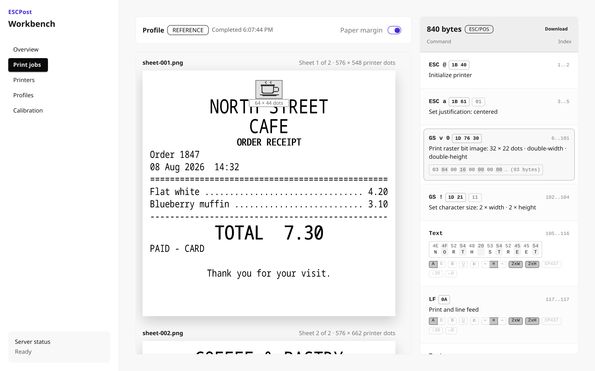

<p align="center">
  <picture>
    <source media="(prefers-color-scheme: dark)" srcset="docs/assets/readme/hero_dark.png">
    <source media="(prefers-color-scheme: light)" srcset="docs/assets/readme/hero_light.png">
    
  </picture>
</p>

ESCPost lets you build, test, and debug ESC/POS receipt and label printing
without a printer on your desk. It is one open-source command-line tool with a
browser workbench, plus libraries for Rust, Python, and JavaScript.

## Is this for you?

- **You waste paper on each test.**
  Render ESC/POS bytes to a PNG at printer resolution.
- **Your ERP or POS prints garbage and you cannot see why.**
  Point it at ESCPost as a network printer. The workbench shows each job live
  and maps each command to the exact area it printed.
- **You do not know which printers are on the network.**
  ESCPost finds USB and network printers and registers them for you.
- **Each printer model behaves differently.**
  A profile catalog holds the geometry and capabilities of each device. You
  can calibrate a profile against your own printer.
- **You must print from a script or a CI job.**
  One CLI and a local HTTP API send raw bytes to USB and network printers. On
  Windows, USB printing needs no driver replacement.
- **Your web application must print receipts.**
  The JavaScript SDK and browser extension print from a web page to a local
  printer. A compatibility shim lets a page that uses QZ Tray keep its `qz.*`
  calls.
- **You want the renderer inside your own application.**
  Use the Rust crates or the Python binding.

<p align="center">
  <picture>
    <source media="(prefers-color-scheme: dark)" srcset="docs/assets/readme/workbench_dark.png">
    <source media="(prefers-color-scheme: light)" srcset="docs/assets/readme/workbench_light.png">
    
  </picture>
</p>

## Quick start

Install the CLI with Homebrew:

```bash
brew install receiptful/tap/escpost
```

Or from crates.io with Rust 1.89 or newer:

```bash
cargo install escpost
```

Render ESC/POS data to a PNG. The input can be raw bytes, readable hexadecimal
text, or stdin:

```bash
escpost render receipt.bin > receipt.png
```

Start the virtual printer and the workbench:

```bash
escpost serve --listen 9100 --web-listen 9000
```

Point your application at `127.0.0.1:9100` as a network printer, or send a
file yourself:

```bash
escpost print receipt.bin --network 9100
```

Find your physical printers, register one, and print to it:

```bash
escpost printers discover
escpost printers add
escpost print receipt.bin
```

The [CLI reference](docs/CLI.md) describes each command and option.

## What ESCPost covers, and what it does not

ESCPost implements the commonly used ESC/POS commands: text and layout, common
single-byte code pages, bit and raster images, one-dimensional barcodes,
GS1-128, QR codes, feeds, and cuts. Each cut starts a new sheet. The
[command coverage](docs/COMMAND_COVERAGE.md) matrix lists each command and how
it was validated.

- A preview shows the printable geometry and the exact position of each dot.
  It does not show paper texture or the proprietary ROM fonts of a printer.
- Linux and Windows are verified with physical printers. The Windows installer
  is not yet released to the public. macOS installs through Homebrew but is
  not yet verified. See [platform support](docs/PLATFORMS.md).
- Printers connect through USB or RAW TCP. Serial and Bluetooth are
  planned.
- Cloud printing is planned. Until then,
  [Receiptful](https://receiptful.io) supplies managed cloud printing as a
  separate product.

## Libraries

| Library | Use it to |
|---|---|
| [`escpost-render`](crates/escpost-render) (Rust) | Convert ESC/POS data into PNG sheets with a selected printer profile. Results include warnings and device events. |
| [`escpost-profiles`](crates/escpost-profiles) (Rust) | Find printer profiles in the embedded catalog, read their capabilities, and compile your own. |
| [`escpost-python`](python) (Python) | Call the same renderer from Python. Not yet on PyPI; build it from this repository. |
| [`@receiptful.io/escpost`](sdks/javascript) (JavaScript) | List printers and print raw bytes from a web page, through the [browser extension](browser-extension). Includes the QZ Tray shim. |

The virtual printer, the workbench, and printer management are CLI features.
They are not available as library APIs.

## Documentation

- [CLI reference](docs/CLI.md) — commands, inputs, the workbench, and the print API
- [Command coverage](docs/COMMAND_COVERAGE.md) — implemented commands and their validation
- [Printer profiles](docs/PROFILE_SCHEMA.md) — profile schema and corrections
- [Platform support](docs/PLATFORMS.md) — operating systems and connection types
- [Architecture](docs/ARCHITECTURE.md) — crates and the render pipeline
- [Command tracing](docs/TRACING.md) — how the workbench maps commands to print areas
- [Testing and calibration](docs/TESTING.md) — test layers, golden images, and physical printers
- [Design decisions](docs/DESIGN_DECISIONS.md) — accepted decisions and their reasons
- [Roadmap](docs/TODO.md) — planned work
- [Manifesto](MANIFESTO.md) — why ESCPost exists

## Contributing

Docker Compose runs the full development stack; you need no Rust or Bun on
your computer. See [CONTRIBUTING.md](CONTRIBUTING.md).

## Usage data

On the first interactive run, the CLI asks if it may share anonymous usage
data: the command name, option names, success or error kind, duration,
version, and platform. It never sends receipts, file names, printer names,
addresses, or anything that identifies you. Switch it off at any time with
`escpost telemetry off`, `DO_NOT_TRACK=1`, or `ESCPOST_TELEMETRY=0`. Details:
<https://escpost.dev/dataprivacy>, reference: [`docs/CLI.md`](docs/CLI.md#usage-data).

## License

ESCPost code and documentation are licensed under the
[Apache License 2.0](LICENSE). Bundled third-party assets retain their own
licenses and attribution.

ESC/POS is a registered trademark of Seiko Epson Corporation. ESCPost is an
independent open-source project and is not affiliated with or endorsed by
Epson.
